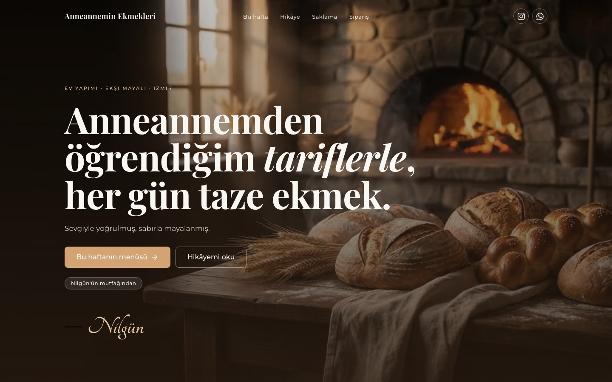
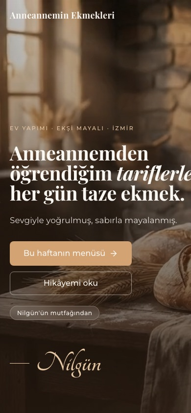

# Anneannemin Ekmekleri

İzmir'de ev yapımı ekşi mayalı ekmek satan küçük bir fırın için tanıtım ve sipariş sayfası.

**Canlı:** https://anneannemin-ekmekleri.vercel.app

<p>
  
  
</p>

## Ne var

- Video arka planlı hero, video yüklenemezse görsele düşüyor
- Haftalık ekmek menüsü, hikâye bölümü, ekmek saklama rehberi
- WhatsApp üzerinden sipariş
- Kaydırınca buzlu cama dönen sabit menü, mobil uyumlu düzen

## Teknik

Tek bir `index.html`. Build adımı, framework ya da paket yöneticisi yok. CSS ve JavaScript dosyanın içinde. Fontlar Google Fonts'tan, ikonlar Lucide'dan geliyor. Vercel'de statik olarak yayında.

Yerelde açmak için:

```bash
open index.html
```
